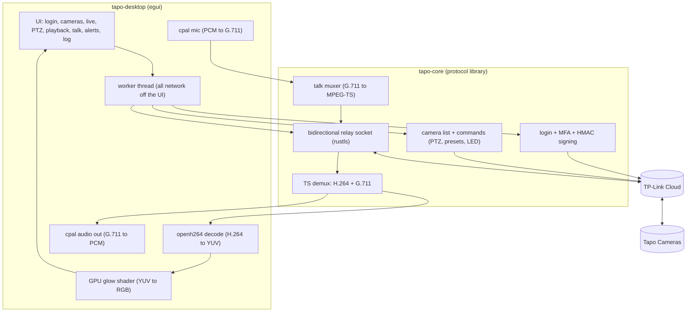

# tapo-desktop

Remote live view, pan/tilt, playback, talk-back and alerts for **TP-Link Tapo cameras** on
**Linux, macOS and Windows**.

No RTSP, no LAN access, nothing to enable on the camera.

Sign in with your TP-Link account (two-factor supported) and view your cameras from anywhere.

## Features

- **Live view + audio** for every camera (1080p H.264 / G.711), decoded and shown in-window.
- **Pan / tilt**, **presets** and **patrol/sweep**.
- **Talk-back**: push your microphone to the camera speaker.
- **Playback** of SD-card recordings by day.
- **Camera controls**: LED, privacy mode, siren/alarm arming.
- **Alerts**: desktop-polled motion / person / sound notifications.

## Download

Builds are produced automatically by GitHub Actions on the [Releases](../../releases) page.
`latest` tracks `main`; `v*` tags are stable. No installer.

- **macOS**: unzip, then run this once and open it:
  ```sh
  xattr -dr com.apple.quarantine "Tapo Desktop.app"
  ```
- **Windows**: a single `tapo-desktop.exe`. Just run it.
- **Linux**: a single executable. Run `chmod +x` on it, then run it.

## Workspace

| Crate | Role |
|-------|------|
| [`crates/tapo-core`](crates/tapo-core) | Protocol library: login + MFA, camera list, cloud relay (live/playback/talk), device commands, alerts. GUI-free and reusable. |
| [`crates/tapo-desktop`](crates/tapo-desktop) | The cross-platform [egui](https://github.com/emilk/egui) app built on `tapo-core`. |

## Build & run

You only need a Rust toolchain with a C compiler (for openh264). No ffmpeg required.

```sh
# Linux also needs: sudo apt-get install libasound2-dev libxkbcommon-dev libwayland-dev libxcb1-dev
cargo run --release -p tapo-desktop
```

## Performance

Video is decoded in software (openh264) and converted to RGB on the GPU (a glow shader), so the
CPU stays free. For lower CPU on macOS there is an experimental hardware-decode path:

```sh
cargo run --release -p tapo-desktop --features hw-videotoolbox   # falls back to openh264
```

## Config location

The session (cloud token, kept so you stay signed in) and the session log file live in your OS
app directories:

| OS | Session | Log file |
|----|---------|----------|
| macOS | `~/Library/Application Support/dev.Dhananjay-JSR.tapo-desktop/session.json` | same folder, `tapo-desktop.log` |
| Linux | `~/.config/tapo-desktop/session.json` | `~/.local/share/tapo-desktop/tapo-desktop.log` |
| Windows | `%APPDATA%\Dhananjay-JSR\tapo-desktop\config\session.json` | `%APPDATA%\Dhananjay-JSR\tapo-desktop\data\tapo-desktop.log` |

The log is recreated each launch. Use **Log > Open log file** in the app to find and share it.
**Log out** deletes the session file.

## Architecture



## Contributing

See [CONTRIBUTING.md](CONTRIBUTING.md).

## Disclaimer

This is an unofficial, community project. It is not affiliated with, authorized, or endorsed by
TP-Link. "Tapo" and "TP-Link" are trademarks of their respective owners. It talks to the TP-Link
cloud, which is undocumented and may change at any time, so the app can break without notice. Use
it at your own risk.

The `ACCESS_KEY`/`SECRET` constants in `tapo-core` are client values embedded in the official app
(the same for every install), not user credentials. Your account token is never committed: it is
stored only in your OS config directory and masked in logs.

## License

MIT
